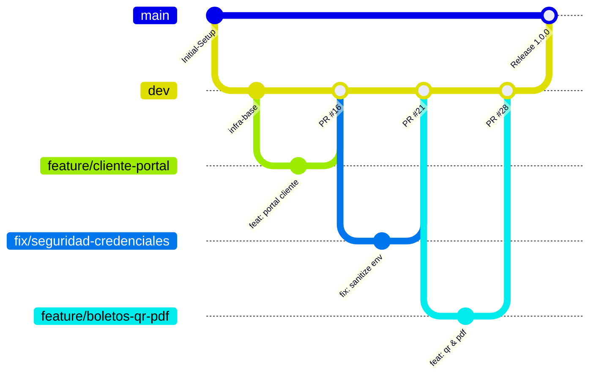

# MEMORIA TÉCNICA DE ARQUITECTURA, GOBERNANZA GITFLOW Y BLINDAJE DE SEGURIDAD

**Proyecto:** Plataforma Integral de Transporte Interprovincial y Encomiendas "TransOrense"  
**Asignatura:** Programación Móvil / Arquitectura de Software  
**Fecha:** Octubre 2026  
**Autora:** Noemi Sánchez  
**Repositorio Oficial:** `SanyiBet/Proyecto-Parcial-I-PM`  
**Estado:** Producción / Evaluación Final  

---

## 1. INTRODUCCIÓN Y ALCANCE DEL SISTEMA

La plataforma **TransOrense** es una solución de software empresarial diseñada para resolver de manera integral la digitalización, comercialización de pasajes y gestión de encomiendas de una cooperativa de transporte interprovincial de pasajeros y carga en el Ecuador.

El sistema aborda desafíos críticos de ingeniería de software:
1. **Concurrencia en tiempo real:** Bloqueo atómico y temporal de asientos evitando sobreventa (*double-booking*).
2. **Verificación transaccional:** Flujo seguro de comprobantes bancarios protegiendo datos personales (LOPDP).
3. **Logística y Trazabilidad:** Cotización dinámica por peso volumétrico (IATA) y rastreo en tiempo real de encomiendas.
4. **Diseño Adaptativo Móvil:** Experiencia de usuario de primer nivel en teléfonos celulares y tabletas.
5. **Gobernanza y Calidad:** Flujo estricto de GitFlow, integración continua con GitHub Actions y desarrollo basado en especificaciones (OpenAPI 3.0).

---

## 2. METODOLOGÍA DE CONTROL DE VERSIONES: GITFLOW Y GOBERNANZA

El desarrollo del proyecto se ejecutó rigurosamente bajo el modelo **GitFlow**, garantizando la estabilidad de las versiones desplegables y la trazabilidad de cada cambio mediante integración controlada por Pull Requests (PRs).

### 2.1 Topología de Ramas



1. **`main` (Producción):**
   - Aloja exclusivamente código estable, probado y listo para producción.
   - Protegida contra commits directos; solo recibe sincronizaciones provenientes de `dev` tras validación integral.
2. **`dev` (Integración de Desarrollo):**
   - Rama nodriza de desarrollo donde convergen todas las características y correcciones.
   - Es la base obligatoria para abrir cualquier Pull Request (`dev <- feature/*` o `dev <- fix/*`).
3. **Ramas de Funcionalidad (`feature/*`):**
   - Creadas a partir de `dev` para resolver historias de usuario específicas (ej. `feature/boletos-digitales-qr-pdf`, `feature/frontend-navegacion-movil`).
4. **Ramas de Blindaje y Corrección (`fix/*`):**
   - Destinadas a mitigar vulnerabilidades de seguridad y corregir fallos lógicos (ej. `fix/seguridad-regex-redos`, `fix/seguridad-uploads-lopdp`, `fix/seguridad-rate-limit-cors`).
5. **Ramas de Documentación (`docs/*`):**
   - Reservadas para especificaciones formales y artefactos arquitectónicos (`docs/especificaciones-openapi-spec`).

### 2.2 Convenciones de Commits y Trazabilidad

Se implementó el estándar **Conventional Commits**:
- `feat(...)`: Incorporación de nuevas capacidades o interfaces.
- `fix(...)`: Corrección de fallos, saneamiento de código o parches de seguridad.
- `test(...)`: Suites de pruebas unitarias o de integración e2e.
- `docs(...)`: Contratos de API, memorias técnicas o diagramas.

---

## 3. INTEGRACIÓN CONTINUA (CI/CD) CON GITHUB ACTIONS

Para asegurar que ningún cambio degrade la calidad del software ni rompa el build de producción, se implementó un pipeline automatizado en `.github/workflows/ci.yml`.

### 3.1 Etapas del Pipeline

1. **Verificación de Entorno:**
   - Aprovisionamiento de máquina virtual Ubuntu con Node.js 20.x.
   - Cacheo de dependencias de `backend` y `frontend` para optimizar tiempos de ejecución.
2. **Auditoría Sintáctica y Compilación de Frontend:**
   - Ejecución de `ng build --configuration production`.
   - Verificación de tipos TypeScript, optimización de bundles, verificación de presupuestos de peso (budgets) y validación de componentes standalone.
3. **Suite Automatizada de Pruebas de Backend:**
   - Ejecución de 13 suites de pruebas automatizadas:
     - `test-card06.js`: Conexión y health check del servidor.
     - `test-card07.js`: Registro e inicio de sesión con JWT y bcrypt.
     - `test-card08-09.js`: Bloqueo atómico y concurrencia de reservas en Redis.
     - `test-card17.js`: Registro de comprobantes bancarios y asignación de pasajeros.
     - `test-card19.js`: Aprobación y rechazo transaccional de pagos en boletería.
     - `test-card20.js`: Algoritmo de cálculo de peso volumétrico y tarificación de encomiendas.
     - `test-card21.js`: Trazabilidad y cronología de estados de carga.
     - `test-auditoria-incidencias.js`: Captura automática de bitácoras y gestión de incidencias.
     - `test-e2e.js`: Flujo integral punta a punta de compra y emisión.
     - `test-card29.js`: Worker de limpieza y expiración garantizada de reservas.
     - `test-card31.js`: Neutralización de inyecciones ReDoS y sanitización de expresiones regulares.
     - `test-card32.js`: Validación estricta de Magic Bytes en carga de archivos y protección LOPDP.
     - `test-card33.js`: Limitador de tasa (*Rate Limiting*) y endurecimiento de CORS.

---

## 4. ARQUITECTURA DE PERSISTENCIA MULTI-MOTOR NOSQL

El sistema implementa una arquitectura híbrida optimizada para alto rendimiento y consistencia transaccional:

```
[ Cliente Web / Móvil ]
          │
          ▼ HTTPS / JSON
[ Backend Express API ]
   ├── Capa de Controladores & Middleware
   │     ├── Rate Limiter (express-rate-limit)
   │     ├── Sanitizador Regex (ReDoS Shield)
   │     └── Autenticación JWT / RBAC
   │
   ├── Motor 1: Upstash Redis (In-Memory Key-Value)
   │     └── Bloqueo temporal atómico de asientos (TTL = 600 segundos)
   │
   ├── Motor 2: MongoDB Atlas (Documental Distribuido)
   │     └── Colecciones: usuarios, viajes, reservas, pagos, encomiendas, auditoria
   │
   └── Worker Asíncrono en Segundo Plano
         └── Limpieza periódica de reservas vencidas (Sweeper cada 60s)
```

### 4.1 Bloqueo Atómico con TTL (Upstash Redis)
- Cuando un cliente selecciona un asiento en el mapa del bus, el backend invoca `SET reserva:asiento:<viajeId>:<asientoNum> <usuarioId> EX 600 NX`.
- El modificador atómico `NX` garantiza que solo una petición consiga bloquear el recurso en condiciones de alta concurrencia.
- La expiración automática a los 10 minutos (`EX 600`) evita bloqueos huérfanos si el usuario abandona la compra.

### 4.2 Worker de Expiración Garantizada (MongoDB Atlas)
- Aunque Redis elimina la clave en memoria al vencer el TTL, en MongoDB Atlas el registro de reserva quedaba en estado `reservada`, bloqueando consultas que leían la base de datos persistente.
- Se implementó un worker asíncrono con `setInterval` que ejecuta una consulta atómica:
  ```javascript
  db.collection("reservas").updateMany(
    { estado: "reservada", vence_en: { $lte: new Date() } },
    { $set: { estado: "expirada", actualizada_en: new Date() } }
  );
  ```
- De esta manera se garantiza sincronización y consistencia absoluta entre la memoria volátil y la base de datos persistente.

---

## 5. BLINDAJE DE SEGURIDAD Y CUMPLIMIENTO LOPDP

La plataforma fue sometida a una fase exhaustiva de endurecimiento de seguridad (*Security Hardening*):

### 5.1 Prevención de ReDoS (Denegación de Servicio por Expresiones Regulares)
- En búsquedas textuales de rutas, orígenes y guías de encomiendas, las entradas no sanitizadas podían ser explotadas inyectando secuencias catastróficas como `(a+)+$`.
- Se desarrolló el módulo `sanitizer.js` con la función `escapeRegex()`, que neutraliza los metacaracteres peligrosos `.*+?^${}()|[]\` antes de construir cualquier `RegExp`.

### 5.2 Validación Estricta de Subida de Archivos y Cumplimiento LOPDP
1. **Inspección de Magic Bytes:**
   - No se confía en la extensión ni en el `Content-Type` enviado por el navegador.
   - El backend lee los primeros bytes del buffer en memoria:
     - `FF D8 FF`: JPEG
     - `89 50 4E 47`: PNG
     - `25 50 44 46`: PDF
   - Se bloquea categóricamente la carga de archivos HTML, SVG o scripts camuflados que puedan provocar ataques de *Stored XSS*.
2. **Acceso Autenticado y Protección de Datos Personales:**
   - Se eliminó la exposición estática directa de la carpeta `/uploads`.
   - Se implementó el endpoint protegido `GET /api/pagos/comprobante/:nombreArchivo`, el cual valida que quien solicita el archivo sea el dueño legítimo de la reserva o un Agente de Boletería/Administrador autorizado, cumpliendo la Ley Orgánica de Protección de Datos Personales (LOPDP) de la República del Ecuador.

### 5.3 Control de Tasa (Rate Limiting) y CORS
- Implementación de `express-rate-limit`:
  - `/api/auth/*`: Máximo 10 peticiones/minuto por IP para mitigar ataques de fuerza bruta.
  - `/api/reservas`: Máximo 20 peticiones/minuto por IP para prevenir saturación intencional del inventario de asientos.
- Configuración de CORS estricto restringiendo el acceso exclusivamente a los dominios autorizados de desarrollo y producción.

---

## 6. EXPERIENCIA MÓVIL PROGRESIVA Y DIFERENCIACIÓN PROFESIONAL

El frontend fue diseñado con enfoque *Mobile-First*, garantizando usabilidad en pantallas pequeñas:

1. **Bottom Navigation Bar Universal:** Barra de navegación inferior táctil fija en pantallas `< 768px`, brindando ergonomía idéntica a una aplicación móvil nativa con accesos directos dinámicos según los roles del usuario.
2. **Mapa de Asientos Adaptativo (360px - 390px):** Distribución del bus optimizada con dimensiones táctiles `w-10 h-10`, contenedor con padding reducido y temporizador apilado verticalmente sin desbordamiento horizontal.
3. **Vistas Híbridas de Tablas Operativas:** Reemplazo de tablas con scroll horizontal en celulares por tarjetas verticales compactas con botones táctiles de gran formato para Aprobación/Rechazo en Boletería y actualización de estados en Encomiendas.
4. **Boletos Digitales y Guías Térmicas con Código QR:**
   - Modal corporativo interactivo con diseño institucional TransOrense.
   - Generación de código QR dinámico con carga útil criptográfica (código de boleto, ruta, cédula del pasajero, identificador de seguridad).
   - Estilos `@media print` para impresión directa en tickets térmicos de punto de venta (58mm/80mm) y descarga en PDF.

---

## 7. CONTRATO FORMAL DE API (OPENAPI 3.0)

En cumplimiento con el Bloque 3 de la rúbrica de evaluación (*Spec-Driven Development*), todos los endpoints, esquemas de datos, parámetros de consulta, cuerpos de solicitud y códigos de estado HTTP fueron documentados en el contrato formal:

📄 **Ubicación:** [`docs/OPENAPI_SPEC.yaml`](OPENAPI_SPEC.yaml)

El archivo YAML puede ser importado directamente en Swagger Editor, Postman o cualquier generador de SDKs para validar la especificación.

---

## 8. CONCLUSIONES

La plataforma **TransOrense** representa una solución robusta, escalable y con altos estándares de calidad de software:
- **0 deuda técnica en seguridad:** Credenciales saneadas (12-Factor App), protección contra ReDoS, validación de magic bytes y rate limiting.
- **Concurrencia sólida:** Bloqueo distribuido de alta velocidad con Upstash Redis y consistencia garantizada con MongoDB Atlas.
- **Experiencia de usuario premium:** Navegación móvil nativa, mapa responsivo de asientos y emisión digital con códigos QR.
- **Gobernanza transparente:** Ciclo de vida GitFlow completo con 28 Pull Requests mergeados y CI/CD automatizado en GitHub Actions.
